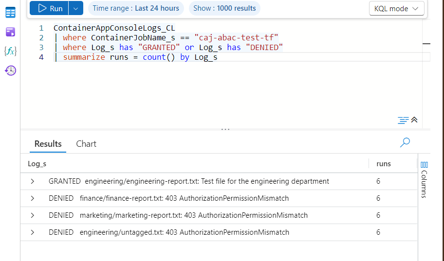
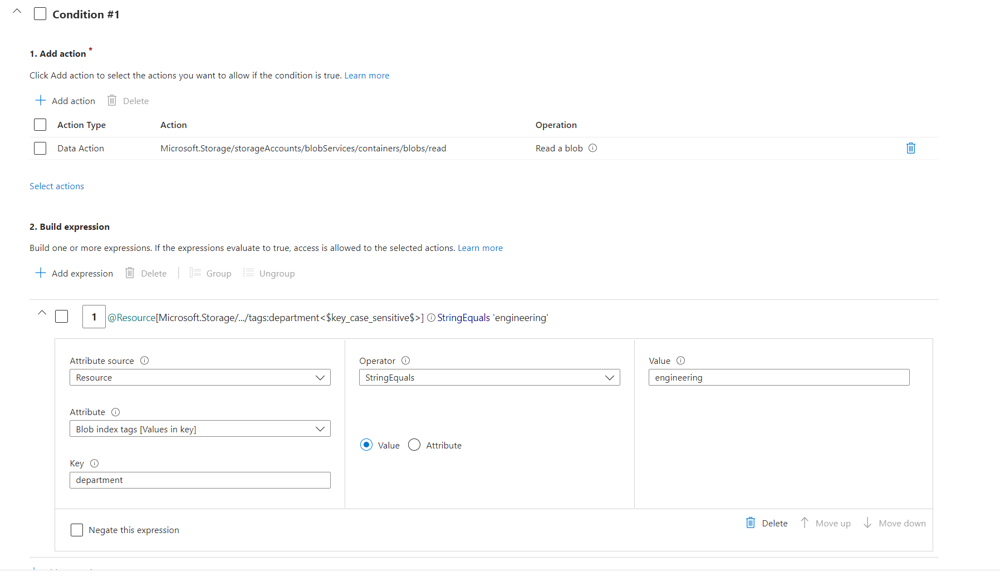

# ABAC on Azure Container Apps

A Python script in a container, running in Azure Container Apps as a managed identity, that can read blobs tagged `department=engineering` and nothing else. There are no keys, passwords or connection strings anywhere: the storage account, the container registry and the Terraform state all use Entra ID.

It's a rebuild of my AWS project, [abac-ecs-fargate](https://github.com/alexjwills/abac-ecs-fargate), which runs the same test on ECS Fargate with a tag-matching IAM policy. I kept the goal and the test the same and built it the way Azure does things, so the two can be compared directly. The IAM side of the AWS version is in [terraform-portfolio](https://github.com/alexjwills/terraform-portfolio).

## Result

The job lists every blob, then tries to read four of them. Run six times, it gave the same result every time:

| Blob | Container | `department` tag | Result |
| --- | --- | --- | --- |
| engineering-report.txt | engineering | engineering | Granted |
| finance-report.txt | finance | finance | Denied, 403 `AuthorizationPermissionMismatch` |
| marketing-report.txt | marketing | marketing | Denied, 403 |
| untagged.txt | engineering | none | Denied, 403 |

The untagged file is there on purpose. It sits in the engineering container and is still refused, which shows that access comes from the tag and not from where the file is stored. A file someone forgets to tag gets no access through this rule, so the mistake fails closed.



## How it fits together


1. The image is built on my PC from `app/Dockerfile`. It installs pinned dependencies from `requirements.txt` and runs as a non-root user.
2. I push it to the registry using `az acr login`, which swaps my Entra sign-in for a short-lived registry token. The registry's admin user is switched off, so there's no password to use or leak.
3. The Container Apps job pulls the image using the managed identity, which has AcrPull on that registry only. In AWS this needed a separate execution role. Here one identity pulls the image and runs the code.
4. The script uses `DefaultAzureCredential`. The job sets `AZURE_CLIENT_ID` to the identity's client ID, which tells it which identity to sign in as. On my own machine the same code signs in as me instead, with no changes.
5. Whatever the script prints goes to Log Analytics, where a KQL query shows the results.

## The access rule

The managed identity has **Storage Blob Data Reader** on the storage account, with a condition attached to the role assignment:

```
(
 (
  !(ActionMatches{'Microsoft.Storage/storageAccounts/blobServices/containers/blobs/read'} AND NOT SubOperationMatches{'Blob.List'})
 )
 OR
 (
  @Resource[Microsoft.Storage/storageAccounts/blobServices/containers/blobs/tags:department<$key_case_sensitive$>] StringEquals 'engineering'
 )
)
```

Read as plain English: either the request isn't a blob read, or the blob's `department` index tag is `engineering`. Listing is left out of the condition on purpose, because a list request covers many blobs at once and can't be checked against one blob's tag. That means the identity can see every file name but read only engineering's contents. The AWS version has the same gap with `s3:ListBucket`.

The portal shows the same rule in its visual editor:



The test files are tagged with **blob index tags**, not metadata. Index tags are indexed by the storage service, so they can be searched and used in conditions. Metadata can't.

## Layout

```
bootstrap/   Storage for Terraform state. Local state, kept between sessions
infra/       Everything else. Remote state, destroyed after every session
app/         app.py, requirements.txt and the Dockerfile
scripts/     upload-test-blobs.sh
docs/images/ Screenshots
```

**bootstrap/** creates a resource group, a storage account and a `tfstate` container. Shared key access is off, so the only way in is Entra ID plus a role. I gave my own user Storage Blob Data Contributor on that one account. Terraform locks the state file with a blob lease, which does the job a DynamoDB table did for S3 state.

**infra/** holds the project itself: the managed identity, the data storage account and its three containers (one `for_each` block), the role assignments, the registry, the Log Analytics workspace, the Container Apps environment and the job. Every resource is tagged and has a `-tf` suffix so Terraform-built resources are easy to spot. The subscription ID is passed in as `TF_VAR_subscription_id` and never written to a file.

**Role assignments**, all scoped to a single resource:

| Who | Role | Scope | Why |
| --- | --- | --- | --- |
| Managed identity | Storage Blob Data Reader, with the condition | Data storage account | The access being tested |
| Managed identity | AcrPull | Registry | Pull its own image |
| Me | Storage Blob Data Owner | Data storage account | Upload test files and set index tags. Contributor can't set index tags |
| Me | AcrPush | Registry | Push the image |

**scripts/upload-test-blobs.sh** uploads one tagged file to each department container, plus the untagged file. Test data is data, not infrastructure, so it's loaded by script rather than Terraform. The script stops on the first error (`set -euo pipefail`) and is safe to run again.

## Findings

**The subscription couldn't create storage.** The first apply made the resource group, then failed with `MissingSubscriptionRegistration: The subscription is not registered to use namespace 'Microsoft.Storage'`. A new subscription only has a handful of resource providers registered, and recent versions of the `azurerm` provider no longer register the full list for you. I registered the five this project needs (Storage, ManagedIdentity, ContainerRegistry, App and OperationalInsights) with `az provider register`. The next apply picked up from state and created only what was missing.

**The Container Apps environment rejected its log settings.** The apply failed with "`log_analytics_workspace_id` can only be set when `logs_destination` is set to `log-analytics`". In this provider version the destination has to be set explicitly. Adding `logs_destination = "log-analytics"` fixed it, and the error message named the fix.

**Destroy timed out after 30 minutes.** Everything else was gone within a few minutes, but Terraform stopped on the environment with `polling after Delete: context deadline exceeded`, with the workspace and resource group still waiting behind it. `az containerapp env show` reported `ScheduledForDelete`, so Azure had accepted the delete and was working through it in the background. A Container Apps environment has real infrastructure behind it (a managed Kubernetes platform, networking and a static public IP), so it's closer to deleting an EKS cluster than an ECS cluster on Fargate, which is only a logical grouping and goes instantly. Azure finished on its own, and a second `terraform destroy` cleared the last two resources in under a minute. I've added `timeouts { delete = "60m" }` to the environment.

**Two Docker engines on one machine.** An image built with Docker Desktop closed, and the build warned that the legacy builder was deprecated. `which -a docker` and `dpkg -S` showed `/usr/bin/docker` came from the `docker.io` apt package, with its own engine running inside WSL. Docker Desktop's WSL integration was switched on but couldn't take over the command. I stopped and purged `docker.io`, reset the integration, and checked `docker version` reported Docker Desktop before rebuilding with BuildKit.

**IDs change when resources are rebuilt.** Because `infra/` is destroyed after every session, the managed identity comes back with a new client ID and principal ID each time. Every role assignment and environment variable refers to the identity through a Terraform reference, never a copied ID, so a rebuild always points at the identity that exists now.

## AWS and Azure side by side

| | AWS (ECS Fargate) | Azure (Container Apps) |
| --- | --- | --- |
| Registry | ECR | Container Registry, admin user off |
| Pulling the image | Execution role | The same managed identity, with AcrPull |
| Running the code | Task role | Managed identity, chosen with `AZURE_CLIENT_ID` |
| Access rule | One policy comparing the role's tag with the object's tag | A condition on the role assignment, with a fixed tag value |
| Where the rule lives | Attached to the role | Attached to the assignment (who, role and scope together) |
| Denied | `AccessDenied` | 403 `AuthorizationPermissionMismatch` |
| Logs | CloudWatch Logs | Log Analytics and KQL |
| Image architecture | arm64, built on a Mac | amd64, built on Windows |
| Container user | root | non-root |
| Deleting the compute | Instant | 15 to 30 minutes |

The biggest design difference is how the identity is matched. The AWS policy compares the role's `department` tag with the object's tag, so one policy works for every department. Here the value `engineering` is fixed in this identity's role assignment. Azure can compare an attribute of the identity too, using Entra custom security attributes, but that needs a paid Entra licence, so for this lab I chose the fixed value.

## Bicep comparison

The `bicep/` folder rebuilds the resource group and managed identity in Bicep, so I could compare it with Terraform on the same small piece. `main.bicep` deploys at subscription scope, creates the resource group, and calls `identity.bicep` as a module scoped to that group.

| | Terraform | Bicep |
| --- | --- | --- |
| Clouds | Azure, AWS and many others | Azure only |
| Record of what exists | A state file, which needed its own storage | None. Azure is the record, plus its deployment history |
| Preview | `terraform plan`, compared with state | `az deployment sub what-if`, compared with live Azure |
| API versions | Chosen by the provider | Set in each resource line. I used stable versions, not previews |
| Clean-up | `terraform destroy` removes what's in state | No destroy. Delete the resource group, or use a Deployment Stack |

I'd use Terraform for anything spanning clouds or needing a strong record of what it manages, and Bicep where a team is Azure-only and wants new Azure features as soon as they ship.

To try it: `az deployment sub what-if --location uksouth --template-file bicep/main.bicep`, then the same with `create`, and `az group delete --name rg-abac-bicep` to remove it.

## Known gaps

- Listing isn't covered by the condition, so the identity can see every blob name. The same is true of `ListBucket` in the AWS version.
- The storage account and the registry accept connections from the internet, although every request needs an Entra identity with the right role. Private endpoints would close that off, and they're part of my next networking project.
- The Log Analytics workspace has shared keys switched on, and the Container Apps environment uses one to send its logs. Routing logs through Azure Monitor diagnostic settings would remove that key.
- Builds and pushes are done by hand. A pipeline is next.

## Running it

You'll need Terraform (pinned to 1.17.2 in `.terraform-version`), the Azure CLI signed in with `az login`, Docker and Python 3.

Storage account and registry names are global across Azure, so change `sttfstateajwtf`, `stabacdataajwtf` and `acrabacajwtf` to your own. The backend block in `infra/versions.tf` names the state storage directly, because backends can't use variables.

```bash
# Once per subscription
for ns in Microsoft.Storage Microsoft.ManagedIdentity Microsoft.ContainerRegistry Microsoft.App Microsoft.OperationalInsights; do
  az provider register --namespace "$ns"
done

export TF_VAR_subscription_id=$(az account show --query id -o tsv)

# State storage (kept)
cd bootstrap && terraform init && terraform apply && cd ..

# Everything else
cd infra && terraform init
terraform plan -out=abac.tfplan
terraform apply abac.tfplan
cd ..

# Test data (wait a couple of minutes if the new role isn't active yet)
./scripts/upload-test-blobs.sh stabacdataajwtf

# Image
docker build -t abac-azure-demo:v1 app/
az acr login --name acrabacajwtf
docker tag abac-azure-demo:v1 acrabacajwtf.azurecr.io/abac-azure-demo:v1
docker push acrabacajwtf.azurecr.io/abac-azure-demo:v1

# Run the job once
az containerapp job start --name caj-abac-test-tf --resource-group rg-abac-tf
```

On a first build the job doesn't exist until the image is in the registry, so either push the image after an apply that leaves out the job, or apply again once it's pushed.

Results take two to five minutes to reach Log Analytics. In the `log-abac-tf` workspace:

```kusto
ContainerAppConsoleLogs_CL
| where ContainerJobName_s == "caj-abac-test-tf"
| where Log_s has "GRANTED" or Log_s has "DENIED"
| summarize runs = count() by Log_s
```

`az containerapp job start` starts a new run every time it's called, so run it once.

To tear down, run `terraform destroy` in `infra/` and leave it alone for up to 30 minutes while the environment is removed. Interrupting it can leave the state lock held. `bootstrap/` stays in place for next time.

## Tools

Terraform 1.17 with the `azurerm` provider 5.x, Azure CLI, Azure Container Registry, Azure Container Apps, Log Analytics and KQL, Azure Storage with blob index tags, Entra ID managed identities and role assignment conditions, Python 3.14 with `azure-identity` and `azure-storage-blob`, Docker with BuildKit, Bash.
