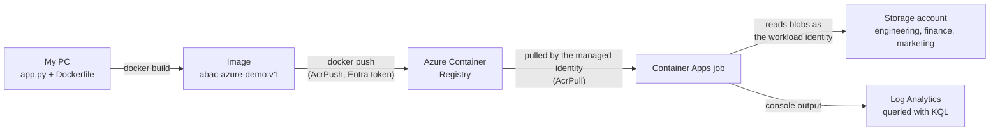
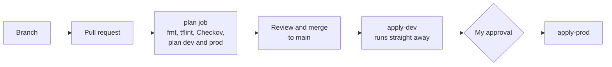

# ABAC on Azure Container Apps

A Python script in a container, running in Azure Container Apps as a managed identity, that can read blobs tagged `department=engineering` and nothing else. There are no keys, passwords or connection strings anywhere: the storage account, the container registry and the Terraform state all use Entra ID.

It's a rebuild of my AWS project, [abac-ecs-fargate](https://github.com/alexjwills/abac-ecs-fargate), which runs the same test on ECS Fargate with a tag-matching IAM policy. I kept the goal and the test the same and built it the way Azure does things, so the two can be compared directly. The IAM side of the AWS version is in [terraform-portfolio](https://github.com/alexjwills/terraform-portfolio).

The infrastructure is deployed by GitHub Actions. Every pull request is formatted, linted, security scanned and planned against both a dev and a prod environment. A merge deploys dev straight away, and prod waits for my approval. The pipeline signs in to Azure, and to AWS, with OIDC, so the repository holds no cloud credentials at all.

## Result

The job lists every blob, then tries to read four of them. Run six times, it gave the same result every time:

| Blob | Container | `department` tag | Result |
| --- | --- | --- | --- |
| engineering-report.txt | engineering | engineering | Granted |
| finance-report.txt | finance | finance | Denied, 403 `AuthorizationPermissionMismatch` |
| marketing-report.txt | marketing | marketing | Denied, 403 |
| untagged.txt | engineering | none | Denied, 403 |

The untagged file is there on purpose. It sits in the engineering container and is still refused, which shows that access comes from the tag and not from where the file is stored. A file someone forgets to tag gets no access through this rule, so the mistake fails closed.


## How it fits together



1. The image is built on my PC from `app/Dockerfile`. It installs pinned dependencies from `requirements.txt` and runs as a non-root user.
2. I push it to the registry using `az acr login`, which swaps my Entra sign-in for a short-lived registry token. The registry's admin user is switched off, so there's no password to use or leak.
3. The Container Apps job pulls the image using the managed identity, which has AcrPull on that registry only. In AWS this needed a separate execution role. Here one identity pulls the image and runs the code.
4. The script uses `DefaultAzureCredential`. The job sets `AZURE_CLIENT_ID` to the identity's client ID, which tells it which identity to sign in as. On my own machine the same code signs in as me instead, with no changes.
5. Whatever the script prints goes to Log Analytics, where a KQL query shows the results.

Each environment gets its own copy of all of this, with the environment in every name: `rg-abac-dev-tf`, `stabacdevajwtf`, `acrabacprodajwtf` and so on.

## The access rule

The managed identity has **Storage Blob Data Reader** on the storage account, with a condition attached to the role assignment:

```
(
 (
  !(ActionMatches{'Microsoft.Storage/storageAccounts/blobServices/containers/blobs/read'} AND NOT SubOperationMatches{'Blob.List'})
 )
 OR
 (
  @Resource[Microsoft.Storage/storageAccounts/blobServices/containers/blobs/tags:department<$key_case_sensitive$>] StringEquals 'engineering'
 )
)
```

In other words: either the request isn't a blob read, or the blob's `department` index tag is `engineering`. Listing is left out of the condition on purpose, because a list request covers many blobs at once and can't be checked against one blob's tag. That means the identity can see every file name but read only engineering's contents. The AWS version has the same gap with `s3:ListBucket`.

The portal shows the same rule in its visual editor:


The test files are tagged with **blob index tags**, not metadata. Index tags are indexed by the storage service, so they can be searched and used in conditions. Metadata can't.

## The pipeline



`main` is protected by a ruleset. Nothing reaches it except through a pull request whose `plan` check has passed against an up-to-date copy of `main`, force pushes and deletion are blocked, and the bypass list is empty, so the rules apply to me too. The ruleset requires 0 approvals, because GitHub doesn't let the author of a pull request approve it and I'm the only person on this repo. The human approval sits on the prod deployment instead. On a team I'd require at least one reviewer as well.

**On every pull request** the `plan` job runs, cheapest checks first, so a failure stops it before it signs in to anything:

| Step | What it catches |
| --- | --- |
| `terraform fmt -check -recursive` | Formatting, across every folder |
| tflint, with the azurerm ruleset | Things `validate` misses: unused declarations, missing version constraints, Azure-specific mistakes |
| Checkov on the module | Security misconfigurations, and it blocks on any new finding |
| init, validate and plan for dev, then prod | What would actually change in each environment |

Plan runs on every pull request, before anyone has reviewed it, so it signs in as an identity that can look at everything and change nothing.

**After a merge** the apply workflow runs, if the module or an environment changed. `apply-dev` runs in the `dev` GitHub environment and starts straight away. `apply-prod` has `needs: apply-dev`, so it only starts if dev succeeded, and it runs in the `production` environment, which waits for me to approve it. Each job makes a fresh plan with `-out` and applies exactly that file, rather than trusting the plan shown on the pull request.

### Identities

There are three pipeline identities, and none of them has a stored secret. Each one trusts GitHub's OIDC tokens only when the token's subject matches this repository and the way the workflow was started.

| Identity | Trusted when the token comes from | Can do |
| --- | --- | --- |
| `id-github-actions-tf` (plan) | `main`, or a pull request | Reader on the subscription. Blob Data Contributor on the state storage account, to read and lock state |
| `id-github-apply-tf` (apply) | The `production` or `dev` environment | Contributor on the subscription. Blob Data Contributor on the state account. Role Based Access Control Administrator, limited by a condition to four roles |
| `GitHub-Actions-Role-tf` (AWS) | `main` | Nothing. It has no policies attached, so it can prove who it is and do nothing else |

The apply identity needs to create role assignments, because the module creates AcrPull, AcrPush, the ABAC reader role and my Blob Data Owner role. Owner or User Access Administrator would let it grant any role, including Owner to itself. Instead it has Role Based Access Control Administrator with a condition that only allows assigning or removing those four roles, by their built-in role IDs:

```
(
 (
  !(ActionMatches{'Microsoft.Authorization/roleAssignments/write'})
 )
 OR
 (
  @Request[Microsoft.Authorization/roleAssignments:RoleDefinitionId] ForAnyOfAnyValues:GuidEquals {...four role IDs...}
 )
)
AND
(
 (
  !(ActionMatches{'Microsoft.Authorization/roleAssignments/delete'})
 )
 OR
 (
  @Resource[Microsoft.Authorization/roleAssignments:RoleDefinitionId] ForAnyOfAnyValues:GuidEquals {...four role IDs...}
 )
)
```

It's the same condition language as the ABAC rule above, applied to role assignments instead of blobs.

Because the apply identity only trusts tokens whose subject names the `production` or `dev` environment, the approval is enforced by Entra ID as well as by GitHub. Taking the environment out of the workflow file doesn't get around it: GitHub then issues a token with a different subject, and Entra ID refuses it.

The IDs the workflows need (client, tenant and subscription IDs, the AWS role ARN) aren't credentials, but they're stored as GitHub secrets so they're masked in the Actions logs, which are public on a public repository. The apply identity's client ID is an environment secret, so only jobs running in `dev` or `production` can read it.

### Dev and prod

```
modules/abac-app/   everything the project builds, written once
envs/dev/           calls the module with environment = "dev"
envs/prod/          calls the module with environment = "prod" and ZRS storage
```

I used a folder per environment calling one module, rather than Terraform workspaces, so each environment has its own state file (`abac-dev.tfstate`, `abac-prod.tfstate`), its own plan and its own approval gate, and there's no "which workspace am I in?" step to get wrong. The module validates its `environment` input, so a typo fails at plan time. The only setting that differs is storage replication: LRS in dev, ZRS in prod, where a whole data centre can fail without losing data.

### Scanner findings

Checkov's first scan raised 17 failed checks. I decided on every one rather than switch the scanner off, then made it blocking, so only new problems stop a pull request.

| Decision | Checks | Why |
| --- | --- | --- |
| Fixed | Soft delete | Deleted blobs and containers are now kept for 7 days |
| Not applicable | Queue logging | The account has no queues |
| Accepted | Seven registry checks (geo-replication, zone redundancy, quarantine, signing and others) | Premium tier features. Paying for Premium without the private network most of them assume would only buy a green tick |
| Accepted | LRS replication, Microsoft-managed keys | Reasonable for short-lived lab data |
| Deferred | Public network access, private endpoints | My next project builds the private networking |
| Deferred | Image vulnerability scanning, blob read logging | A later project covers Defender for Cloud and logging |

Each accepted or deferred check is skipped with a `#checkov:skip=ID:reason` line inside the resource, so the reason sits next to the code. tflint's `prevent_destroy` rule is switched off in `.tflint.hcl` for the same kind of reason: this lab is destroyed after every session, and `prevent_destroy` would block that.

Every action in the workflows is pinned to a full commit SHA with the version as a comment (`actions/checkout@11d5960a... # v4`). A version tag can be moved to different code by whoever controls the action's repository, which is what happened in the `tj-actions/changed-files` compromise in March 2025. A SHA can't be moved.

## Layout

```
bootstrap/           State storage and the two Azure pipeline identities. Local state
bootstrap-aws/       GitHub OIDC provider and role in AWS. Local state
modules/abac-app/    The project itself, as a reusable module
envs/dev/            Dev environment. Remote state, deployed by the pipeline
envs/prod/           Prod environment. Remote state, deployed after approval
.github/workflows/   Plan, apply, and two sign-in tests (Azure and AWS)
app/                 app.py, requirements.txt and the Dockerfile
scripts/             upload-test-blobs.sh
bicep/               The Bicep comparison
docs/images/         Screenshots
```

**bootstrap/** creates a resource group, a storage account and a `tfstate` container. Shared key access is off, so the only way in is Entra ID plus a role. Terraform locks the state file with a blob lease, which does the job a DynamoDB table did for S3 state. It also creates the plan and apply identities, their federated credentials and their roles. It's applied from my laptop, because the pipeline can't create the identity it runs as.

**modules/abac-app/** holds the managed identity, the data storage account and its three containers (one `for_each` block), the role assignments, the registry, the Log Analytics workspace, the Container Apps environment and the job. Every resource is tagged with its environment and has a `-tf` suffix so Terraform-built resources are easy to spot.

**Role assignments the module creates**, all scoped to a single resource:

| Who | Role | Scope | Why |
| --- | --- | --- | --- |
| Managed identity | Storage Blob Data Reader, with the condition | Data storage account | The access being tested |
| Managed identity | AcrPull | Registry | Pull its own image |
| Me | Storage Blob Data Owner | Data storage account | Upload test files and set index tags. Contributor can't set index tags |
| Me | AcrPush | Registry | Push the image |

My object ID is passed in as a variable (`admin_object_id`), from `TF_VAR_admin_object_id` locally and a GitHub secret in the pipeline, so the result is the same whoever runs Terraform. See the second pipeline finding below for why.

**scripts/upload-test-blobs.sh** uploads one tagged file to each department container, plus the untagged file. Test data is data, not infrastructure, so it's loaded by script rather than Terraform. The script stops on the first error (`set -euo pipefail`) and is safe to run again.

## Findings

### Building the project

**The subscription couldn't create storage.** The first apply made the resource group, then failed with `MissingSubscriptionRegistration: The subscription is not registered to use namespace 'Microsoft.Storage'`. A new subscription only has a handful of resource providers registered, and recent versions of the `azurerm` provider no longer register the full list for you. I registered the five this project needs (Storage, ManagedIdentity, ContainerRegistry, App and OperationalInsights) with `az provider register`. The next apply picked up from state and created only what was missing.

**The Container Apps environment rejected its log settings.** The apply failed with "`log_analytics_workspace_id` can only be set when `logs_destination` is set to `log-analytics`". In this provider version the destination has to be set explicitly. Adding `logs_destination = "log-analytics"` fixed it, and the error message named the fix.

**Destroy timed out after 30 minutes.** Everything else was gone within a few minutes, but Terraform stopped on the environment with `polling after Delete: context deadline exceeded`, with the workspace and resource group still waiting behind it. `az containerapp env show` reported `ScheduledForDelete`, so Azure had accepted the delete and was working through it in the background. A Container Apps environment has real infrastructure behind it (a managed Kubernetes platform, networking and a static public IP), so it's closer to deleting an EKS cluster than an ECS cluster on Fargate, which is only a logical grouping and goes instantly. Azure finished on its own, and a second `terraform destroy` cleared the last two resources in under a minute. I've added `timeouts { delete = "60m" }` to the environment.

**Two Docker engines on one machine.** An image built with Docker Desktop closed, and the build warned that the legacy builder was deprecated. `which -a docker` and `dpkg -S` showed `/usr/bin/docker` came from the `docker.io` apt package, with its own engine running inside WSL. Docker Desktop's WSL integration was switched on but couldn't take over the command. I stopped and purged `docker.io`, reset the integration, and checked `docker version` reported Docker Desktop before rebuilding with BuildKit.

**IDs change when resources are rebuilt.** Because the environments are destroyed after every session, the managed identity comes back with a new client ID and principal ID each time. Every role assignment and environment variable refers to the identity through a Terraform reference, never a copied ID, so a rebuild always points at the identity that exists now.

### Building the pipeline

**GitHub's token subject didn't match.** The first sign-in from GitHub Actions failed with `AADSTS700213: No matching federated identity record found`. The error included the subject GitHub had sent, `repo:alexjwills@<owner-id>/abac-azure-container-apps@<repo-id>:ref:refs/heads/main`, and the credential trusted `repo:alexjwills/abac-azure-container-apps:ref:refs/heads/main`. Repositories created after 15th July 2026 use GitHub's immutable subject format, which adds the owner and repository IDs so a trust can't be picked up by someone who later registers the same names. I copied the exact subject from the error into every credential. It's the same class of fault as the IRSA trust policy mismatch in my Kubernetes lab: compare what was sent with what is trusted, character by character.

**My roles would have gone to the pipeline.** The first plan from GitHub Actions showed the Storage Blob Data Owner assignment, meant for me, with a `principal_id` I didn't recognise. `az identity show` confirmed it was the plan identity's. The assignment took its principal from `data.azurerm_client_config.current.object_id`, which means whoever is running Terraform: me on my laptop, the pipeline identity in GitHub. The plan was valid and nothing would have errored, but once the pipeline applied, I'd have lost my access and the pipeline would have gained Blob Data Owner on the data account, which bypasses the ABAC condition. I replaced it with an `admin_object_id` variable, and the next plan showed the value masked and `principal_type = "User"`.

**A required check that never runs blocks every pull request.** A pull request that only changed `bootstrap/` sat at "Waiting for status to be reported" with merging disabled. The plan workflow had a path filter so it only ran for infrastructure changes, but the ruleset requires the `plan` check on every pull request, so GitHub waited for a result that was never coming. I removed the path filter. A plan with no changes costs nothing. For the same reason, when I added the second environment I kept both plans in one job called `plan`, because a matrix would have renamed the check.

**A new registry is empty.** The first apply from the pipeline built everything except the Container Apps job, which failed with `MANIFEST_UNKNOWN: manifest tagged by "v1" is not found`. Azure checks the image exists when the job is created, and the registry had only just been created. Terraform had recorded everything else in state and released the lock, so after I pushed the image, a re-run added only the job. The same happens once per environment. When dev failed this way, `needs: apply-dev` stopped prod from starting at all.

**The AWS account ID wasn't masked.** The AWS sign-in test printed the account ID in plain text in a public log, even though the role ARN was a secret. GitHub masks exact secret values, and AWS printed an assumed-role ARN and the bare account ID, neither of which matched the secret. I added the account ID as its own secret, but it still wasn't masked, because the runner only receives, and so only masks, secrets the workflow refers to. Referencing it in the job's `env` fixed it, and I deleted the earlier run.

## AWS and Azure side by side

| | AWS (ECS Fargate) | Azure (Container Apps) |
| --- | --- | --- |
| Registry | ECR | Container Registry, admin user off |
| Pulling the image | Execution role | The same managed identity, with AcrPull |
| Running the code | Task role | Managed identity, chosen with `AZURE_CLIENT_ID` |
| Access rule | One policy comparing the role's tag with the object's tag | A condition on the role assignment, with a fixed tag value |
| Where the rule lives | Attached to the role | Attached to the assignment (who, role and scope together) |
| Denied | `AccessDenied` | 403 `AuthorizationPermissionMismatch` |
| Logs | CloudWatch Logs | Log Analytics and KQL |
| Image architecture | arm64, built on a Mac | amd64, built on Windows |
| Container user | root | non-root |
| Deleting the compute | Instant | 15 to 30 minutes |
| Trusting GitHub Actions | An IAM OIDC provider (issuer and audience, once per account), plus conditions on `aud` and `sub` in each role's trust policy | A federated credential per subject, holding issuer, audience and subject together |

The biggest design difference is how the identity is matched. The AWS policy compares the role's `department` tag with the object's tag, so one policy works for every department. Here the value `engineering` is fixed in this identity's role assignment. Azure can compare an attribute of the identity too, using Entra custom security attributes, but that needs a paid Entra licence, so for this lab I chose the fixed value.

## Bicep comparison

The `bicep/` folder rebuilds the resource group and managed identity in Bicep, so I could compare it with Terraform on the same small piece. `main.bicep` deploys at subscription scope, creates the resource group, and calls `identity.bicep` as a module scoped to that group.

| | Terraform | Bicep |
| --- | --- | --- |
| Clouds | Azure, AWS and many others | Azure only |
| Record of what exists | A state file, which needed its own storage | None. Azure is the record, plus its deployment history |
| Preview | `terraform plan`, compared with state | `az deployment sub what-if`, compared with live Azure |
| API versions | Chosen by the provider | Set in each resource line. I used stable versions, not previews |
| Clean-up | `terraform destroy` removes what's in state | No destroy. Delete the resource group, or use a Deployment Stack |

I'd use Terraform for anything spanning clouds or needing a strong record of what it manages, and Bicep where a team is Azure-only and wants new Azure features as soon as they ship.

To try it: `az deployment sub what-if --location uksouth --template-file bicep/main.bicep`, then the same with `create`, and `az group delete --name rg-abac-bicep` to remove it.

## Known gaps

- Listing isn't covered by the condition, so the identity can see every blob name. The same is true of `ListBucket` in the AWS version.
- The storage account and the registry accept connections from the internet, although every request needs an Entra identity with the right role. Private endpoints would close that off, and they're part of my next networking project.
- The Log Analytics workspace has shared keys switched on, and the Container Apps environment uses one to send its logs. Routing logs through Azure Monitor diagnostic settings would remove that key.
- The image is still built and pushed by hand, so each environment's first apply fails on the job until the image is in its registry. Building and pushing the image in the pipeline, or creating the job in a later stage, would fix that.
- Dev and prod share one apply identity, so the dev job could change prod resources. The stricter design is an identity per environment with Contributor on its own resource group only, with the resource groups created in bootstrap.
- The approval happens before the prod job runs its own plan, so I approve on the strength of the pull request's plan. Splitting plan and apply into separate jobs would let the approver see the exact plan that will run.
- tflint and Checkov scan the module and the environments, but not `bootstrap/` or `bootstrap-aws/`.
- The two apply jobs are almost identical. A reusable workflow would remove the duplication.
- Pinned actions don't update themselves. Dependabot would raise a pull request with each new version's SHA.

## Running it

You'll need Terraform (pinned to 1.17.2 in `.terraform-version`), the Azure CLI signed in with `az login`, Docker and Python 3. For the AWS part, the AWS CLI signed in to an account you can create IAM resources in.

Storage account and registry names are global across Azure, so change `sttfstateajwtf` in `bootstrap/` and the `stabac...ajwtf` and `acrabac...ajwtf` patterns in the module to your own. The backend blocks in `envs/*/versions.tf` name the state storage directly, because backends can't use variables. The federated credential subjects in `bootstrap/` and the trust policy in `bootstrap-aws/` name this repository and its IDs, so change those to your own as well.

### Once: state storage, pipeline identities and GitHub settings

```bash
for ns in Microsoft.Storage Microsoft.ManagedIdentity Microsoft.ContainerRegistry Microsoft.App Microsoft.OperationalInsights; do
  az provider register --namespace "$ns"
done

export TF_VAR_subscription_id=$(az account show --query id -o tsv)
export TF_VAR_admin_object_id=$(az ad signed-in-user show --query id -o tsv)

cd bootstrap && terraform init && terraform apply && cd ..
cd bootstrap-aws && terraform init && terraform apply && cd ..
```

Then in the repository settings on GitHub:

- **Repository secrets:** `AZURE_CLIENT_ID` (the plan identity), `AZURE_TENANT_ID`, `AZURE_SUBSCRIPTION_ID`, `AZURE_ADMIN_OBJECT_ID`, `AWS_ROLE_ARN` and `AWS_ACCOUNT_ID`.
- **Environments:** `dev` with no reviewers, and `production` with a required reviewer and admin bypass off. Both limited to deployments from `main`, and both with an `AZURE_APPLY_CLIENT_ID` secret holding the apply identity's client ID.
- **Ruleset on the default branch:** require a pull request, require the `plan` status check with branches up to date, block force pushes and deletion.

The `bootstrap` outputs print both client IDs and the tenant ID. `terraform -chdir=bootstrap output -raw github_apply_client_id` prints one value on its own, ready to paste.

### Deploying

Open a pull request with a change under `modules/` or `envs/`, check the plans for both environments, and merge. Dev deploys on its own, and prod waits under **Actions** for approval.

On a first build, each environment's apply stops at the job because its registry is empty. Push the image, then re-run the failed job:

```bash
docker build --platform linux/amd64 -t abac-azure-demo:v1 app/
az acr login --name acrabacdevajwtf
docker tag abac-azure-demo:v1 acrabacdevajwtf.azurecr.io/abac-azure-demo:v1
docker push acrabacdevajwtf.azurecr.io/abac-azure-demo:v1
```

Then load the test data and run the job once, here for dev:

```bash
./scripts/upload-test-blobs.sh stabacdevajwtf
az containerapp job start --name caj-abac-test-dev-tf --resource-group rg-abac-dev-tf
```

Wait a couple of minutes before uploading if your Blob Data Owner role has only just been created. `az containerapp job start` starts a new run every time it's called, so run it once.

Results take two to five minutes to reach Log Analytics. In the `log-abac-dev-tf` workspace:

```kusto
ContainerAppConsoleLogs_CL
| where ContainerJobName_s == "caj-abac-test-dev-tf"
| where Log_s has "GRANTED" or Log_s has "DENIED"
| summarize runs = count() by Log_s
```

The same Terraform can be run locally from `envs/dev` or `envs/prod` with `terraform init` and `terraform plan`, with both `TF_VAR_` variables set as above.

### Tearing down

From `envs/dev` and `envs/prod`, run `terraform destroy` in each. The two have separate state, so they can run side by side in two terminals. Leave each alone for up to 30 minutes while its Container Apps environment is removed, because interrupting it can leave the state lock held. `bootstrap/` and `bootstrap-aws/` stay in place for next time, and cost nothing while idle apart from a few pence of state storage.

## Tools

Terraform 1.17 with the `azurerm` provider 5.x and the `aws` provider 5.x, Terraform modules, GitHub Actions with OIDC, GitHub rulesets and environments, tflint with the azurerm ruleset, Checkov, Azure CLI, Azure Container Registry, Azure Container Apps, Log Analytics and KQL, Azure Storage with blob index tags, Entra ID managed identities, federated credentials and role assignment conditions, AWS IAM OIDC providers and STS, Python 3.14 with `azure-identity` and `azure-storage-blob`, Docker with BuildKit, Bash.
